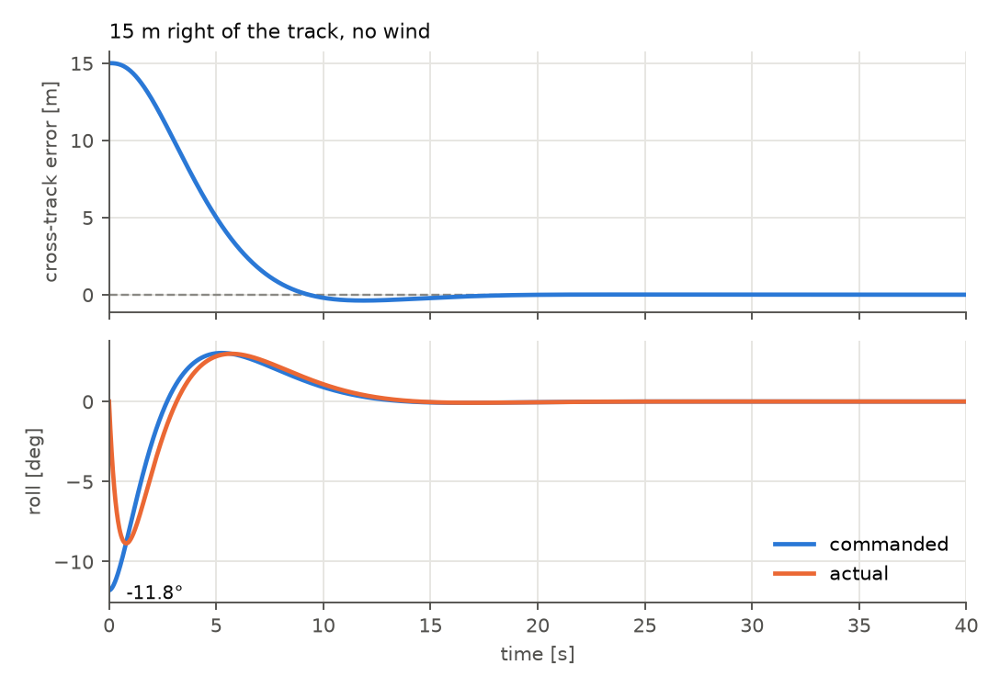
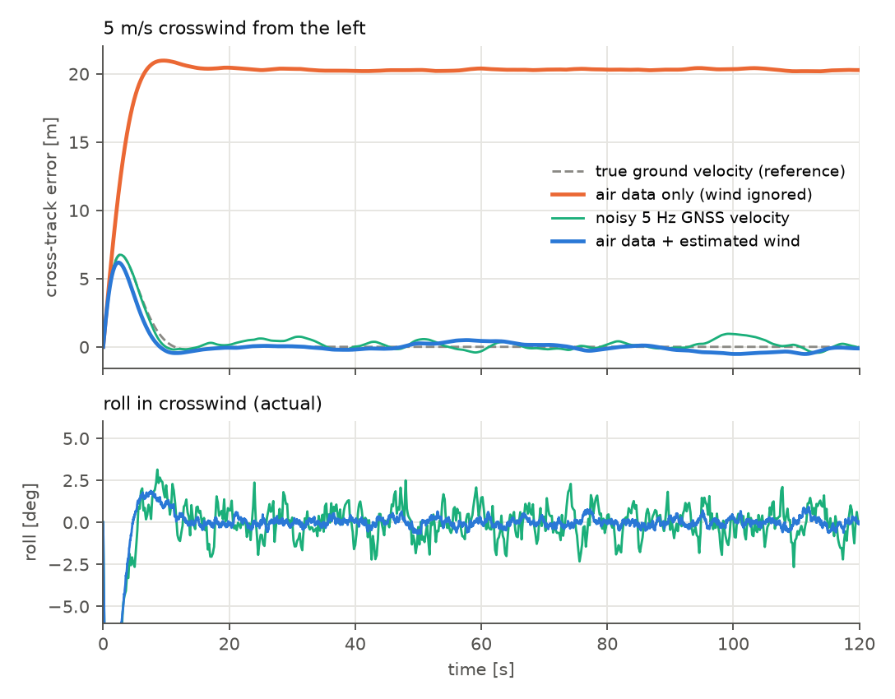
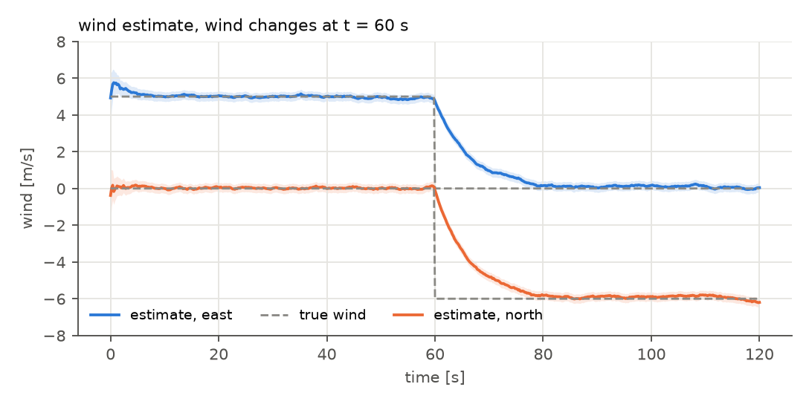
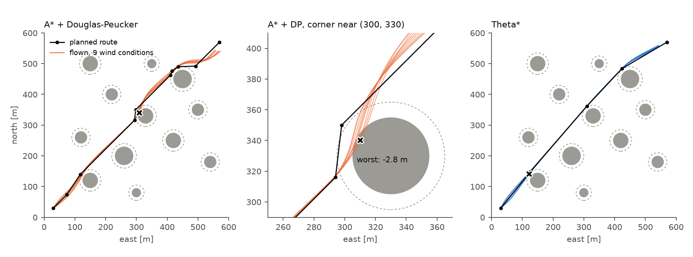
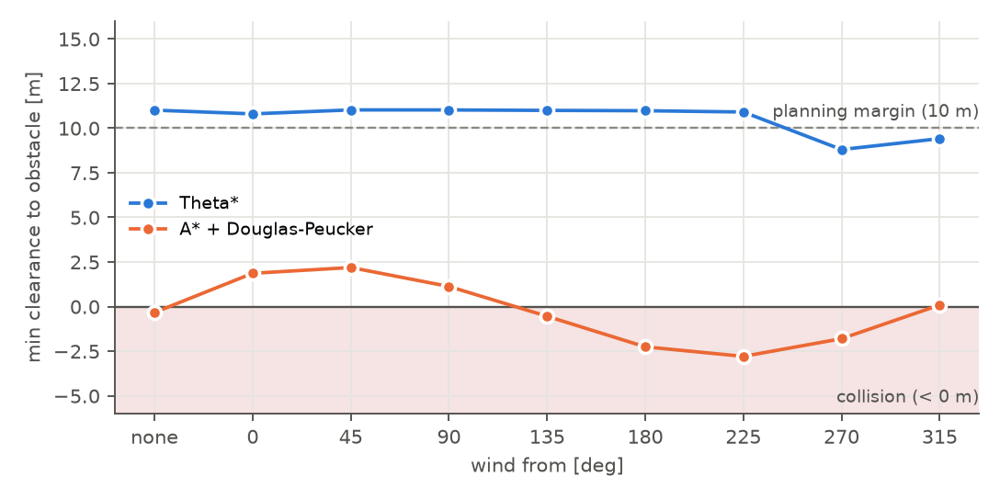

# uav-route-guidance

[](https://github.com/gurkankilinc/uav-route-guidance/actions/workflows/tests.yml)

Path planning, route simplification and lateral guidance for a small fixed-wing UAV,
built as one pipeline instead of four disconnected exercises:

```
A* / Theta* route  ->  Douglas-Peucker simplification  ->  L1 path following in wind  ->  approach a moving target
      (8.1)                       (8.4)                              (8.3)                        (8.2)
```

The final step validates the simulated guidance against ArduPlane SITL.


## Status

| Stage | Module | State |
|---|---|---|
| Obstacle-avoiding route (A*, inflated grid) | `uavguide/planner.py` | done |
| Any-angle route (Theta*) and planner comparison | `uavguide/theta_star.py` | done |
| Collision-aware Douglas-Peucker | `uavguide/simplify.py` | done |
| Fixed-wing model + ArduPlane-style L1 guidance + wind (XTE) | `uavguide/vehicle.py`, `uavguide/guidance.py`, `uavguide/sim.py` | done |
| Wind estimation (Kalman) as a velocity source for the guidance | `uavguide/wind.py`, `uavguide/sensors.py` | done |
| Moving target + approach speed profile (8.2) | `uavguide/target.py`, `uavguide/pursuit.py` | done |
| Planner registry, metrics, scenarios, Monte Carlo comparison | `uavguide/planners.py`, `metrics.py`, `scenarios.py`, `compare.py` | done |
| Look-ahead zone guard (turn-aware safety layer) | `uavguide/safety.py` | done |
| Streamlit app: animated runs, zone-size sliders, planner comparison | `app/` | next |
| ArduPlane SITL validation (Ubuntu) | `sitl/` | planned |

## Results

### Planning (default scenario, 600 x 600 m, 12 obstacles)

| | A* | Theta* |
|---|---|---|
| Route length | 798.8 m | 770.8 m (straight line 763.7 m) |
| Raw waypoints | 301 | 5 |
| After Douglas-Peucker (eps = 5 m) | 10 | 4 |

Plain DP starts cutting through obstacles at eps >= 12 m; the collision-aware version splits
any span whose shortcut would violate clearance, so it never does.

### Guidance: "15 m right of the track, how much roll?"

The guidance is a port of ArduPilot's `AP_L1_Control::update_waypoint` (L1 = zeta T V / pi,
K = 4 zeta^2, T = 17 s, zeta = 0.75). Flying parallel to the track the speed cancels out:

```
phi = -atan(4 pi^2 e / (g T^2))      ->  e = 15 m: 11.8 deg left,  e = 5 m: 4.0 deg left
```

The simulation reproduces this at 12, 20 and 26 m/s, and the whole time response is speed
independent: the cross-track error drops below 1 m after 7.7 s with 0.38 m overshoot.



### Wind: where the guidance gets its ground velocity matters

| Velocity source (5 m/s crosswind, 10 seeds) | Steady XTE | Actual roll jitter |
|---|---|---|
| True ground velocity (reference) | 0.0 m | 0.00 deg |
| Noisy 5 Hz GNSS velocity | 0.31 m RMS | 0.80 deg |
| Air data only (wind ignored) | **20.3 m** (predicted L1 sin(beta) = 20.3 m) | 0.20 deg |
| Air data + estimated wind | 0.26 m RMS | 0.25 deg |

The estimator is a 2-state Kalman filter on `wind = v_gnss - v_air`. It follows a wind change in
about 17 s and gives the guidance a smooth 50 Hz ground velocity: the same track accuracy as GNSS
with about a third of the roll jitter.




### Is the simplified route flyable?

Both routes were flown in still air and with 5 m/s wind from 8 directions.

| Route | Clearance as planned | Worst clearance as flown | Collisions (of 9) |
|---|---|---|---|
| A* + Douglas-Peucker (10 pts) | 9.1 m | **-2.8 m** | 5 |
| Theta* (5 pts) | 11.0 m | 8.8 m | 0 |

A geometrically safe route is not automatically a flyable one: two 38 deg turns 34 m apart near
(300, 330) cannot be followed with a 58 m turn radius, so the aircraft cuts the corner into the
obstacle. Theta* produces fewer, gentler turns and keeps its margin in every wind. The same
Theta* route flown with air data only (wind ignored) does hit an obstacle (-4.5 m); with the
estimated wind it keeps 9.8 m.




### Pursuing a moving target: which planner is best?

`pursue()` flies the whole 8.2 loop at 50 Hz: the target moves (straight line with smooth turns at
the walls, a circle, or fixed), the route is replanned from the current position every `interval`
seconds, the last waypoint follows the target live and the L1 guidance flies it. The aircraft
aims at the point `d_follow` (40 m) *behind* the target and its speed follows
`v(d) = v_t + (v_max - v_t) tanh((d - d_follow) / d0)`, converted to an airspeed command with the wind
the guidance believes in. "Caught" means within 60 m of the target for 5 s. Zone sizes are a
scenario setting (fixed during a flight); `scale_zones()` grows or shrinks them between runs.

20 random scenarios (12 zones, 5 m/s wind from a random direction, target speed 17 m/s), every planner
on the same scenarios (`python scripts/compare_pursuit.py --seeds 20`):

| Planner | Caught, no violation | Entered a zone | Left the area | Median time to catch | Median plan time |
|---|---|---|---|---|---|
| A* | 55 % | 20 % | 10 % | 86.6 s | 3.4 ms |
| A* + DP | 65 % | 20 % | 15 % | 80.3 s | 4.4 ms |
| Theta* | 70 % | 15 % | 5 % | **65.4 s** | 24.5 ms |
| **Theta\* + DP** | **80 %** | **5 %** | 10 % | 74.0 s | 23.5 ms |

Replanning every 2 s. The same scenarios flown with a **single plan** at the start (`--interval 0`):
0-10 % success and 30-55 % zone violations for every planner, so replanning is what makes pursuit work.
Without the look-ahead guard (`--no-guard`) 65-80 % of the flights enter a zone, because a route
replanned from the current position can start with a turn the aircraft is too fast to make (it needs
a 40-100 m radius, the planning margin is 10 m).

What this says: for a chase, Theta* is the better *search* (shorter routes, fewer waypoints, 25 ms
instead of 4 ms is irrelevant at a 2 s replan interval) and a collision-aware Douglas-Peucker pass on
top of it is cheap insurance. Raw A* (hundreds of 2 m legs) catches less often and later than the simplified routes. The numbers
are from 20 scenarios; use `--seeds 100` for tighter estimates.

All guidance numbers above are written by `scripts/demo_guidance.py` to
[`docs/img/guidance_results.json`](docs/img/guidance_results.json).

## Modeling assumptions

All values live in [`uavguide/config.py`](uavguide/config.py).

| Item | Value |
|---|---|
| Frame | flat earth, constant altitude, x = east, y = north, heading clockwise from north |
| Vehicle | kinematic fixed-wing, coordinated turns, `psi_dot = g tan(phi) / V` |
| Speeds | V_stall 12, cruise 20, V_max 26 m/s, \|dV/dt\| <= 2 m/s^2 |
| Bank | \|phi\| <= 35 deg, first-order response tau = 0.4 s, <= 60 deg/s |
| Min turn radius | V^2 / (g tan phi_max) = 58 m at cruise (91 m over ground downwind in 5 m/s wind) |
| Wind | constant 5 m/s, unknown to the controller unless estimated |
| Sensors | GNSS velocity 5 Hz, 0.5 m/s noise; airspeed 0.5 m/s noise; heading 1 deg noise |
| Obstacles | static circles, known positions, +10 m safety margin |
| L1 guidance | ArduPlane-style: L1 = zeta T V / pi (81 m at 20 m/s), K = 4 zeta^2 = 2.25 |
| Leg switching | ArduPlane `turn_distance`: min(WP radius, L1) scaled by turn angle / 90 deg |
| Target | 17 m/s ground speed: straight line (turns away from walls with R = 60 m), circle or fixed (V_stall < V_target < V_max) |
| Approach | v(d) = v_t + (v_max - v_t) tanh((d - d_follow) / d0), d_follow 40 m, d0 60 m; caught = within 60 m for 5 s |
| Simulation | 50 Hz, explicit Euler |

"Optimal" in 8.1 means the shortest path on the 8-connected grid of the inflated map;
A* with the octile heuristic is guaranteed to find it. Diagonal moves that would cut an
obstacle corner are disallowed.

## Limitations (deliberately out of scope)

Planning ignores the turn radius: routes are geometric and the pursuit relies on the look-ahead guard
(`safety.py`) and replanning to stay clear of zones. Pure pursuit with a trailing aim point, no lead /
intercept prediction. The target does not evade. Planning time is measured, not simulated as latency.

3-D effects and energy management, evasive targets, turbulence/gusts, sensor latency,
airspeed sensor scale errors (the wind estimator assumes a calibrated airspeed). Not ported
from ArduPilot: `_prevent_indecision` and loiter modes.

## Usage

```bash
python -m venv .venv
.venv\Scripts\activate          # Windows  (Linux: source .venv/bin/activate)
pip install -e .[app,dev]
pytest
python scripts/demo_planning.py            # planning figures, default scenario
python scripts/demo_planning.py --seed 7   # random obstacle field
python scripts/compare_planners.py         # A* vs Theta* table
python scripts/demo_guidance.py            # guidance + wind figures and results JSON
python scripts/compare_pursuit.py          # all planners chase a moving target, Monte Carlo table
```

Tests run on every push and pull request (Python 3.11-3.13) via GitHub Actions.
