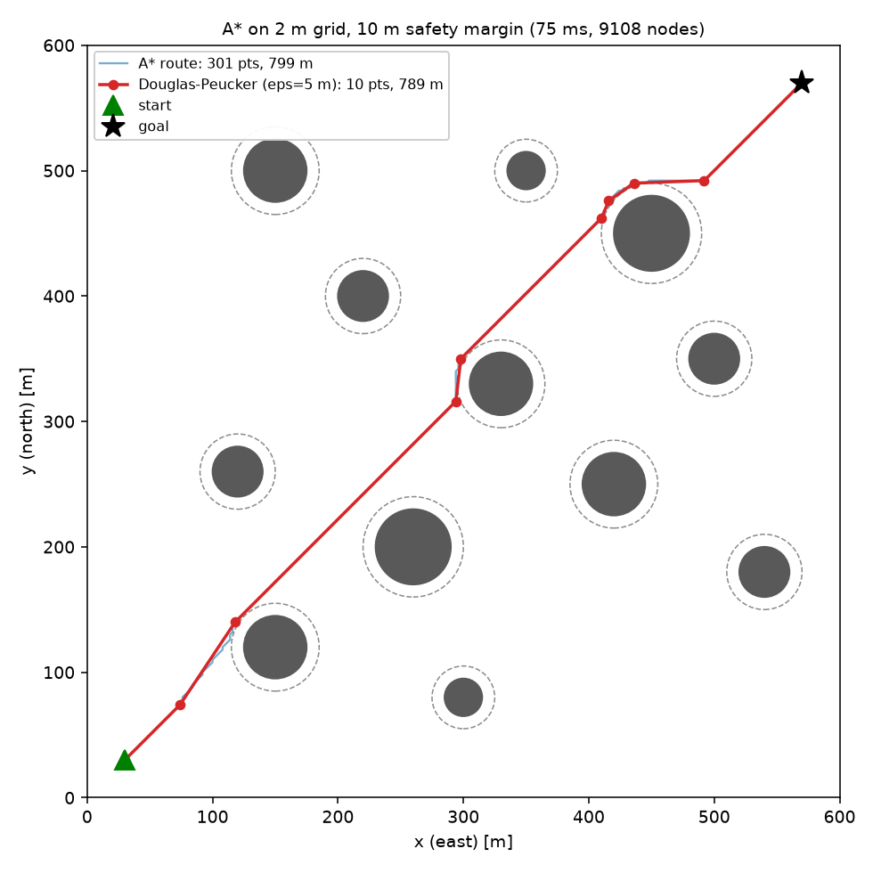
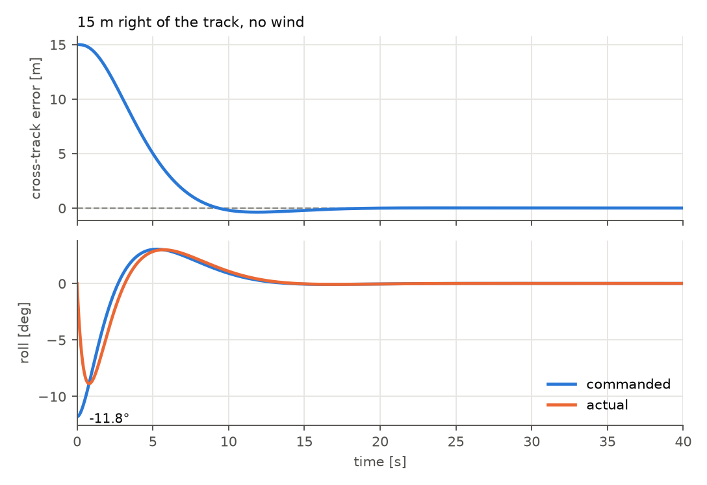
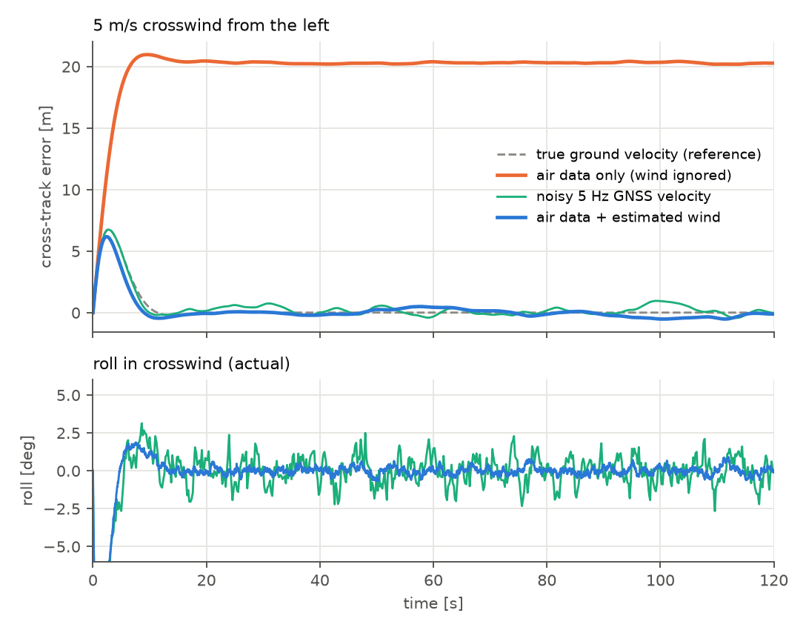
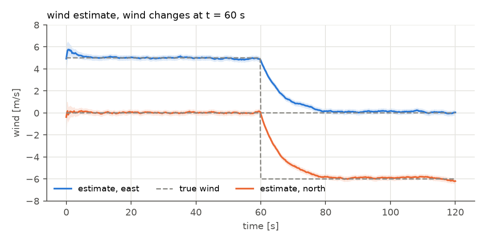
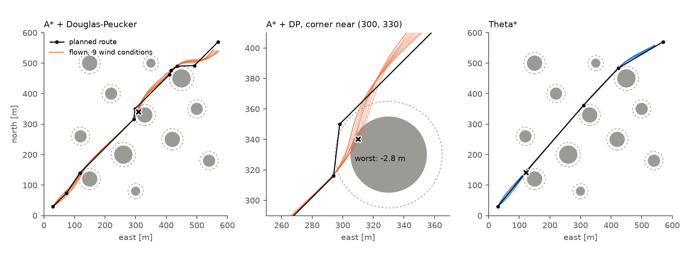
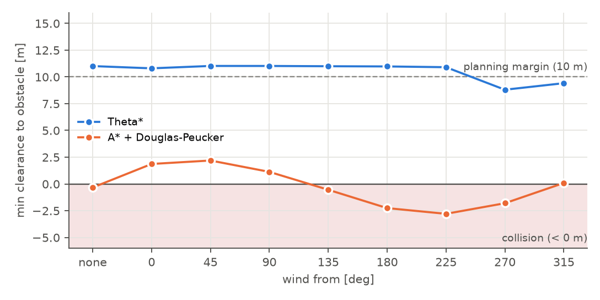
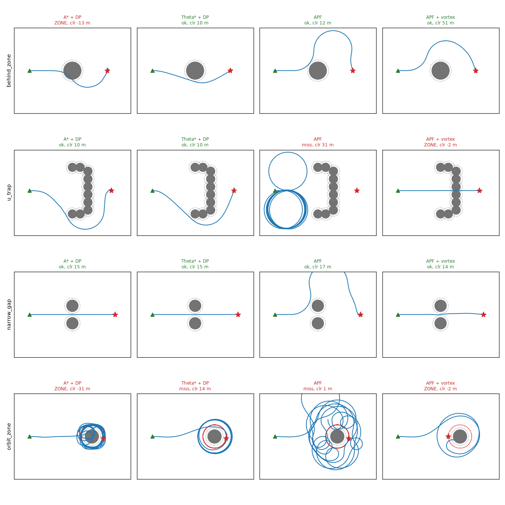
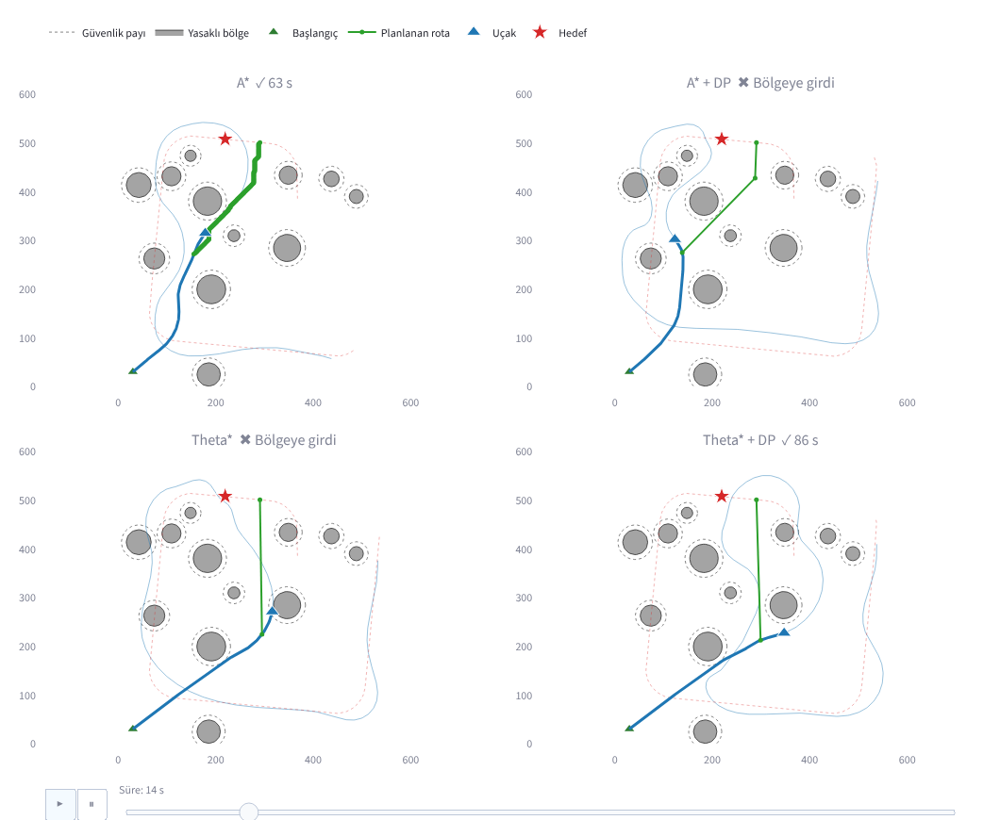
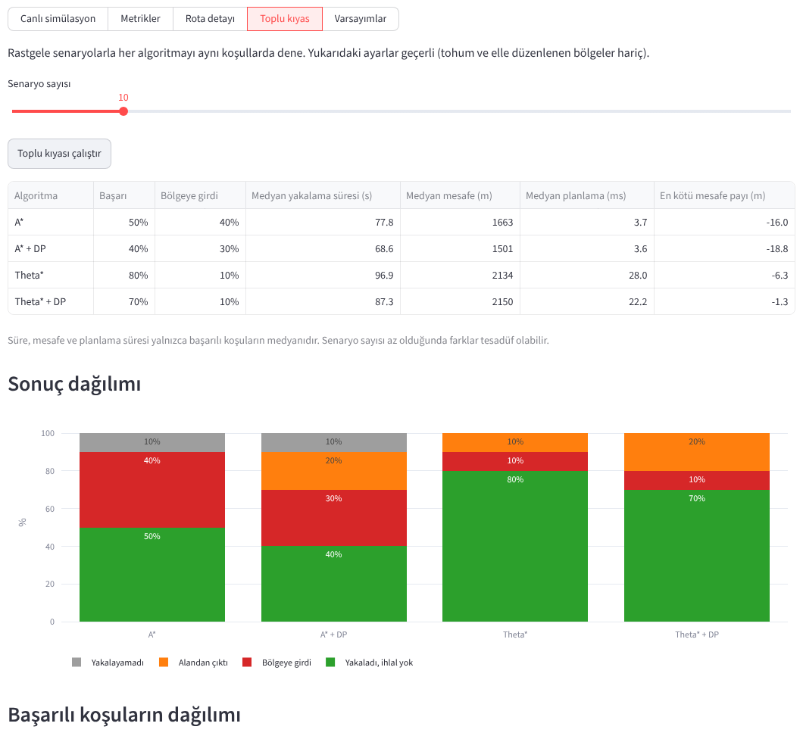

# uav-route-guidance

[](https://github.com/gurkankilinc/uav-route-guidance/actions/workflows/tests.yml)

Path planning, route simplification and lateral guidance for a small fixed-wing UAV,
built as one pipeline instead of four disconnected exercises:

```
A* / Theta* route  ->  Douglas-Peucker simplification  ->  L1 path following in wind  ->  approach a moving target
      (8.1)                       (8.4)                              (8.3)                        (8.2)
```

The final step validates the simulated guidance against ArduPlane SITL.



## Status

| Stage | Module | State |
|---|---|---|
| Obstacle-avoiding route (A*, inflated grid) | `uavguide/planner.py` | done |
| Any-angle route (Theta*) and planner comparison | `uavguide/theta_star.py` | done |
| Collision-aware Douglas-Peucker | `uavguide/simplify.py` | done |
| Fixed-wing model + ArduPlane-style L1 guidance + wind (XTE) | `uavguide/vehicle.py`, `uavguide/guidance.py`, `uavguide/sim.py` | done |
| Wind estimation (Kalman) as a velocity source for the guidance | `uavguide/wind.py`, `uavguide/sensors.py` | done |
| Moving target + approach speed profile (8.2) | `uavguide/target.py`, `uavguide/pursuit.py` | done |
| Navigation core, separate from the simulation | `uavguide/navcore.py` | done |
| Control rate, command delay, route latency, sensor noise in the pursuit | `uavguide/pursuit.py` | done |
| Geodetic conversion and MAVLink telemetry to core state; flight recorder and replay | `uavguide/geo.py`, `uavguide/recorder.py` | done |
| Planner registry, metrics, scenarios, Monte Carlo comparison with confidence intervals and paired tests | `uavguide/planners.py`, `metrics.py`, `scenarios.py`, `compare.py` | done |
| Look-ahead zone guard (turn-aware safety layer) | `uavguide/safety.py` | done |
| Potential-field guidance (classic APF, APF + vortex / Ge & Cui) and stress cases | `uavguide/potential.py`, `scripts/stress_test.py` | done |
| Streamlit app: animated runs, zone-size sliders, planner comparison | `app/` | done |
| ArduPlane SITL validation (Ubuntu) | `sitl/` | planned |

## Results

### Planning (default scenario, 600 x 600 m, 12 obstacles)

| | A* | Theta* |
|---|---|---|
| Route length | 798.8 m | 770.8 m (straight line 763.7 m) |
| Raw waypoints | 301 | 5 |
| After Douglas-Peucker (eps = 5 m) | 10 | 4 |

Plain DP starts cutting through obstacles at eps >= 12 m; the collision-aware version splits
any span whose shortcut would violate clearance, so it never does.

### Guidance: "15 m right of the track, how much roll?"

The guidance is a port of ArduPilot's `AP_L1_Control::update_waypoint` (L1 = zeta T V / pi,
K = 4 zeta^2, T = 17 s, zeta = 0.75). Flying parallel to the track the speed cancels out:

```
phi = -atan(4 pi^2 e / (g T^2))      ->  e = 15 m: 11.8 deg left,  e = 5 m: 4.0 deg left
```

The simulation reproduces this at 12, 20 and 26 m/s, and the whole time response is speed
independent: the cross-track error drops below 1 m after 7.7 s with 0.38 m overshoot.



### Wind: where the guidance gets its ground velocity matters

| Velocity source (5 m/s crosswind, 10 seeds) | Steady XTE | Actual roll jitter |
|---|---|---|
| True ground velocity (reference) | 0.0 m | 0.00 deg |
| Noisy 5 Hz GNSS velocity | 0.31 m RMS | 0.80 deg |
| Air data only (wind ignored) | **20.3 m** (predicted L1 sin(beta) = 20.3 m) | 0.20 deg |
| Air data + estimated wind | 0.26 m RMS | 0.25 deg |

The estimator is a 2-state Kalman filter on `wind = v_gnss - v_air`. It follows a wind change in
about 17 s and gives the guidance a smooth 50 Hz ground velocity: the same track accuracy as GNSS
with about a third of the roll jitter.




### Is the simplified route flyable?

Both routes were flown in still air and with 5 m/s wind from 8 directions.

| Route | Clearance as planned | Worst clearance as flown | Collisions (of 9) |
|---|---|---|---|
| A* + Douglas-Peucker (10 pts) | 9.1 m | **-2.8 m** | 5 |
| Theta* (5 pts) | 11.0 m | 8.8 m | 0 |

A geometrically safe route is not automatically a flyable one: two 38 deg turns 34 m apart near
(300, 330) cannot be followed with a 58 m turn radius, so the aircraft cuts the corner into the
obstacle. Theta* produces fewer, gentler turns and keeps its margin in every wind. The same
Theta* route flown with air data only (wind ignored) does hit an obstacle (-4.5 m); with the
estimated wind it keeps 9.8 m.




### Pursuing a moving target: which method is best?

`pursue()` flies the whole 8.2 loop at 50 Hz. The target moves (straight line with smooth turns at
the walls, a circle, or fixed) and the navigation core returns a bank and an airspeed command:

* the aircraft aims at the point `d_follow` (40 m) *behind* the target,
* **route methods** (A*, Theta*, with or without Douglas-Peucker) replan from the current position
  every `interval` seconds and follow the route with the L1 guidance; the last waypoint tracks the aim,
* **potential-field methods** draw no route: the aim pulls, the zones and the border push, and the
  resulting direction becomes a bank command. The influence distance is two or three turn radii at
  the current airspeed, because a fixed-wing aircraft cannot turn on the spot. "APF + vortex" adds a
  tangential component around zones (against local minima) and the Ge & Cui (2000) goal-distance factor,
* speed follows `v(d) = v_t + (v_max - v_t) tanh((d - d_follow) / d0)`, corrected for the wind the
  aircraft can infer,
* an optional look-ahead **guard** rolls the aircraft's own turn forward and steers away if it would
  enter a zone or leave the area. It is the same for every method.

"Caught" means within 60 m of the target for 5 s without entering a zone or leaving the area.

**100 held-out scenarios** (seeds 200-299: 12 zones, 5 m/s wind from a random direction, 17 m/s target),
every method on the same scenarios, replanning every 2 s (`python scripts/compare_pursuit.py`):

| Method | Guard on: success (95 % interval) | zone entered | left area | guard steering | Guard off: success | zone entered | left area |
|---|---|---|---|---|---|---|---|
| A* | 58 % (48-67) | 26 % | 22 % | 20 % of the time | 15 % | 82 % | 7 % |
| A* + DP | **69 %** (59-77) | 15 % | 14 % | 17 % | 25 % | 73 % | 6 % |
| Theta* | 64 % (54-73) | 16 % | 14 % | 15 % | 35 % | 63 % | 6 % |
| Theta* + DP | 65 % (55-74) | 13 % | 15 % | 15 % | 37 % | 61 % | 4 % |
| APF | 49 % (39-59) | 33 % | 34 % | 13 % | 26 % | 62 % | 67 % |
| APF + vortex | 61 % (51-70) | 27 % | 20 % | 14 % | **43 %** | **39 %** | 35 % |

What the numbers support, using paired tests on the same scenarios (exact McNemar):

* **With the guard, the four best methods cannot be told apart.** A* + DP, Theta*, Theta* + DP and
  APF + vortex differ by 4-8 points with p = 0.28-0.61. Only the classic field is clearly worse than
  the best (20 points, p = 0.005); raw A* is borderline (11 points, p = 0.07).
* **The guard matters more than the choice of planner.** It adds 28-44 points to every route method
  and 18-23 to the fields, and it is steering 13-20 % of the flight time. Without it 61-82 % of the
  route-method flights enter a zone, because a route replanned from the current position can start
  with a turn the aircraft is too fast to make (40-100 m radius against a 10 m planning margin).
* **Without the guard the vortex field is the most robust** (43 %, zone entries 39 %): its influence
  distance already contains the turn radius. It beats A*, A* + DP and the classic field
  (p < 0.02) but not the Theta* variants (p = 0.24 and 0.42). Its weak point is leaving the area.
* **Replanning is essential for the route methods.** With a single plan at the start
  (`--interval 0`) they succeed in 1-25 % of the scenarios.

**A less than ideal link to the aircraft.** The table above assumes the core runs at 50 Hz, its
commands act at once and it knows the exact ground velocity. A real autopilot link (and SITL) does
not. The same 100 scenarios, guard on, each condition compared with the ideal run of the same method
on the same scenarios (exact McNemar):

| Method | Ideal | Noisy 5 Hz GNSS | Air data + wind estimate | 10 Hz core, 0.2 s command delay, 0.3 s route latency | All of it together |
|---|---|---|---|---|---|
| A* | 58 % | 56 % | 55 % | 45 % (p = 0.05) | 46 % (p = 0.07) |
| A* + DP | 69 % | 77 % | 73 % | **53 % (p = 0.02)** | **53 % (p = 0.02)** |
| Theta* | 64 % | 67 % | 72 % | 62 % | 55 % (p = 0.12) |
| Theta* + DP | 65 % | 62 % | 69 % | 58 % | **58 %** (p = 0.28) |
| APF | 49 % | 43 % | 44 % | 37 % (p = 0.06) | 41 % |
| APF + vortex | 61 % | 59 % | 63 % | 51 % (p = 0.10) | 53 % |

* **Measurement noise costs nothing measurable.** Noisy GNSS or the wind estimator change the rates
  by a few points either way, all within chance (p >= 0.15).
* **Timing does.** A slower core with delays costs most methods 7-16 points; for A* + DP the drop is
  significant (p = 0.02). The Theta* variants lose the least (2-9 points, not significant). Under the
  realistic link Theta* + DP comes out on top, but only the classic field is clearly behind it
  (p = 0.02); raw A* is borderline (p = 0.07) and the rest are within chance.
* This is the first thing to check against SITL: the MAVLink link will set the real rate and delay.
  `PursuitPolicy(control_rate_hz=..., command_delay=..., plan_latency=..., velocity_source=...)`, the
  same options in `compare_pursuit.py` (`--rate --delay --plan-latency --source`) and in the app.

An earlier version of this table, from 20 scenarios (seeds 0-19), put Theta* + DP at 80 %. Those
seeds were also the ones the pursuit constants had been tuned on, and 20 runs give an interval of
about +-20 points. The 100 held-out scenarios above are the honest numbers; `scenarios.py` now keeps
tuning seeds (100-199) and test seeds (200-299) apart.

The fields also fail the way the literature predicts (`python scripts/stress_test.py`): in a
hand-built U-trap the classic field circles in front of the trap for 300 s, and the vortex variant
gets out but squeezes between two zones near the goal, where the Ge & Cui factor has weakened the
repulsion.



All guidance numbers above are written by `scripts/demo_guidance.py` to
[`docs/img/guidance_results.json`](docs/img/guidance_results.json).

## Architecture: the navigation core

Everything that decides where the aircraft goes is in `uavguide/navcore.py` and has no simulation
in it:

```python
nav = Navigator("Theta* + DP", cfg, replan_interval=2.0, guard=True)
cmd = nav.update(state, target, zones, dt)      # -> cmd.roll [rad], cmd.airspeed [m/s]
```

`state` is what an autopilot reports (position, heading, bank, airspeed, ground velocity), `target`
is a position and a velocity, `zones` are the no-fly zones known so far and the area border. The
wind is not an input; the core infers it from ground velocity minus air velocity. The built-in
simulation (`pursuit.py`) is one caller of this interface. ArduPlane SITL through MAVLink, or a
companion computer on a real aircraft, would be another, with the same core. A test flies the core
from a bare loop and checks that the path is identical to the simulation's.

Two helpers sit at that boundary:

* `uavguide/geo.py` converts latitude / longitude to the core's east / north metres (WGS-84 tangent
  plane) and builds a `NavState` straight from MAVLink fields (`GLOBAL_POSITION_INT`, `ATTITUDE`,
  `VFR_HUD`).
* `uavguide/recorder.py` writes every core input and output to a JSON-lines file and replays it
  through a fresh core. The core is deterministic, so the replay must reproduce every command exactly;
  when a SITL or real flight looks wrong, this separates "the core decided badly" from "the core was
  given bad data". `python scripts/replay_nav.py flight.jsonl`, or `--method` to ask what another
  method would have done with the same inputs.

## Interactive app

```bash
pip install -e ".[app]"
streamlit run app/streamlit_app.py
```

Pick the scenario in the sidebar (seed, number and size of the no-fly zones, target type and speed, wind,
whether the aircraft has to discover the zones with a sensor), choose the algorithms and whether the
route is planned once or replanned every few seconds, then run. The zone table can be edited by hand
(resize, move, add, delete). Turkish and English UI.

* **Live simulation:** every algorithm on the same scenario side by side, one play button and one time slider.
* **Metrics:** outcome, time to catch, flown distance, planning time and zone clearance per algorithm; a
  ranking that first eliminates failures and then scores the rest with weights you set.
* **Route detail:** step through the routes planned during the flight, and the distance, speed, roll and
  clearance time series.
* **Batch comparison:** the same comparison over many random scenarios, with outcome shares and distributions.




## Modeling assumptions

All values live in [`uavguide/config.py`](uavguide/config.py).

| Item | Value |
|---|---|
| Frame | flat earth, constant altitude, x = east, y = north, heading clockwise from north |
| Vehicle | kinematic fixed-wing, coordinated turns, `psi_dot = g tan(phi) / V` |
| Speeds | V_stall 12, cruise 20, V_max 26 m/s, \|dV/dt\| <= 2 m/s^2 |
| Bank | \|phi\| <= 35 deg, first-order response tau = 0.4 s, <= 60 deg/s |
| Min turn radius | V^2 / (g tan phi_max) = 58 m at cruise (91 m over ground downwind in 5 m/s wind) |
| Wind | constant 5 m/s, unknown to the controller unless estimated |
| Sensors | GNSS velocity 5 Hz, 0.5 m/s noise; airspeed 0.5 m/s noise; heading 1 deg noise |
| Obstacles | static circles, known positions, +10 m safety margin |
| L1 guidance | ArduPlane-style: L1 = zeta T V / pi (81 m at 20 m/s), K = 4 zeta^2 = 2.25 |
| Leg switching | ArduPlane `turn_distance`: min(WP radius, L1) scaled by turn angle / 90 deg |
| Target | 17 m/s ground speed: straight line (turns away from walls with R = 60 m), circle or fixed (V_stall < V_target < V_max) |
| Approach | v(d) = v_t + (v_max - v_t) tanh((d - d_follow) / d0), d_follow 40 m, d0 60 m; caught = within 60 m for 5 s |
| Simulation | 50 Hz, explicit Euler |

"Optimal" in 8.1 means the shortest path on the 8-connected grid of the inflated map;
A* with the octile heuristic is guaranteed to find it. Diagonal moves that would cut an
obstacle corner are disallowed.

## Limitations (deliberately out of scope)

Planning ignores the turn radius: routes are geometric and the pursuit relies on the look-ahead guard
(`safety.py`) and replanning to stay clear of zones. Pure pursuit with a trailing aim point, no lead /
intercept prediction. The target does not evade. Planning time is measured, not simulated as latency.

3-D effects and energy management, evasive targets, turbulence/gusts, sensor latency,
airspeed sensor scale errors (the wind estimator assumes a calibrated airspeed). Not ported
from ArduPilot: `_prevent_indecision` and loiter modes.

## Usage

```bash
python -m venv .venv
.venv\Scripts\activate          # Windows  (Linux: source .venv/bin/activate)
pip install -e .[app,dev]
pytest                                    # includes the app tests (Streamlit AppTest)
streamlit run app/streamlit_app.py         # interactive comparison
python scripts/demo_planning.py            # planning figures, default scenario
python scripts/demo_planning.py --seed 7   # random obstacle field
python scripts/compare_planners.py         # A* vs Theta* table
python scripts/demo_guidance.py            # guidance + wind figures and results JSON
python scripts/compare_pursuit.py --procs 4   # all methods on 100 held-out scenarios, intervals and paired tests
python scripts/stress_test.py              # potential-field weak points (local minimum, U-trap, ...)
```

Tests run on every push and pull request (Python 3.11-3.13) via GitHub Actions.
