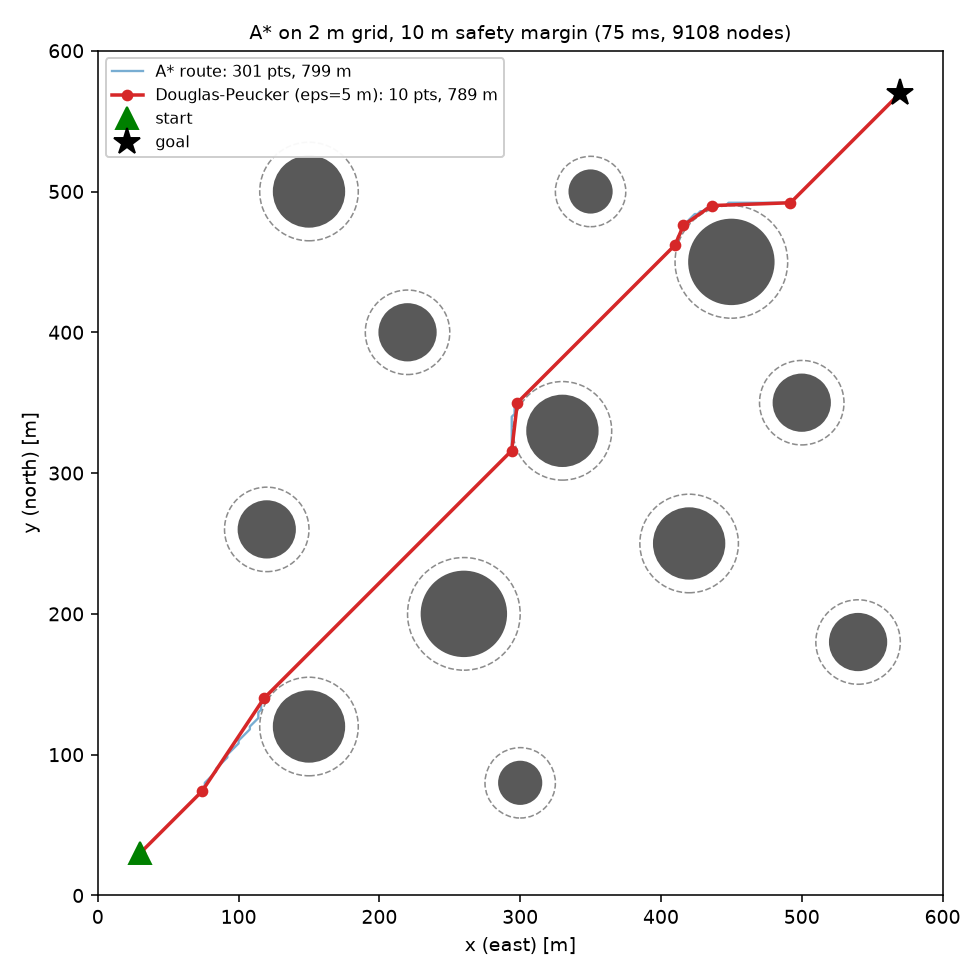
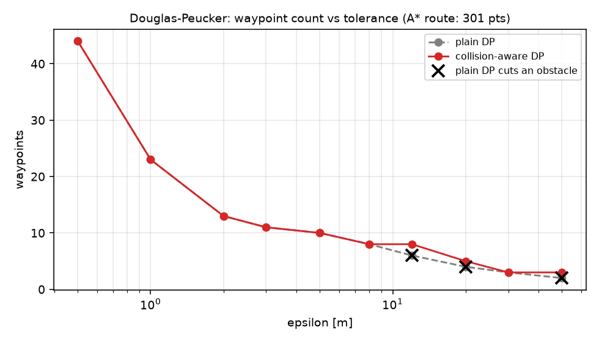

# uav-route-guidance

Path planning, route simplification and lateral guidance for a small fixed-wing UAV,
built as one pipeline instead of four disconnected exercises:

```
A* route  ->  Douglas-Peucker simplification  ->  L1 path following in wind  ->  approach a moving target
 (8.1)              (8.4)                              (8.3)                        (8.2)
```

The final step validates the simulated guidance against ArduPlane SITL.



## Status

| Stage | Module | State |
|---|---|---|
| Obstacle-avoiding route (A*, inflated grid) | `uavguide/planner.py` | done |
| Collision-aware Douglas-Peucker | `uavguide/simplify.py` | done |
| Vehicle model + L1 guidance + wind (XTE) | `uavguide/vehicle.py`, `uavguide/guidance.py` | next |
| Moving target + approach speed profile | `uavguide/target.py` | planned |
| Integrated scenario (PLAN -> NAVIGATE -> INTERCEPT) | `uavguide/sim.py` | planned |
| Streamlit app with parameter sliders | `app/` | planned |
| ArduPlane SITL validation (Ubuntu) | `sitl/` | planned |

## First results (default scenario, 600 x 600 m, 12 obstacles)

- A* on a 2 m grid with a 10 m safety margin: 301 waypoints, 799 m, ~75 ms.
- Douglas-Peucker at eps = 5 m: **301 -> 10 waypoints**, 789 m, min clearance 9.1 m.
- Plain DP starts cutting through obstacles at eps >= 12 m; the collision-aware
  version splits any span whose shortcut would violate clearance, so it never does.



## Modeling assumptions

All values live in [`uavguide/config.py`](uavguide/config.py).

| Item | Value |
|---|---|
| Frame | flat earth, constant altitude, x = east, y = north, heading clockwise from north |
| Vehicle | kinematic fixed-wing, coordinated turns, `psi_dot = g tan(phi) / V` |
| Speeds | V_stall 12, cruise 20, V_max 26 m/s, \|dV/dt\| <= 2 m/s^2 |
| Bank | \|phi\| <= 35 deg, first-order response tau = 0.4 s, <= 60 deg/s |
| Min turn radius | V^2 / (g tan phi_max) = 58 m at cruise |
| Wind | constant 5 m/s from the west, unknown to the controller |
| Obstacles | static circles, known positions, +10 m safety margin |
| L1 guidance | ArduPlane-style: L1 = zeta T V / pi (81 m at 20 m/s), K = 4 zeta^2 = 2.25 |
| Target | 17 m/s, straight line or circle (V_stall < V_target < V_max) |
| Approach | v(d) = v_t + (v_max - v_t) tanh((d - d_follow) / d0), d_follow 40 m, d0 150 m |
| Simulation | 50 Hz, explicit Euler |

"Optimal" in 8.1 means the shortest path on the 8-connected grid of the inflated map;
A* with the octile heuristic is guaranteed to find it. Diagonal moves that would cut an
obstacle corner are disallowed.

## Limitations (deliberately out of scope)

3-D effects and energy management, evasive targets, turbulence/gusts, sensor latency
(added later as an option).

## Usage

```bash
python -m venv .venv
.venv\Scripts\activate          # Windows  (Linux: source .venv/bin/activate)
pip install -e .[app,dev]
pytest
python scripts/demo_planning.py            # default scenario
python scripts/demo_planning.py --seed 7   # random obstacle field
```
